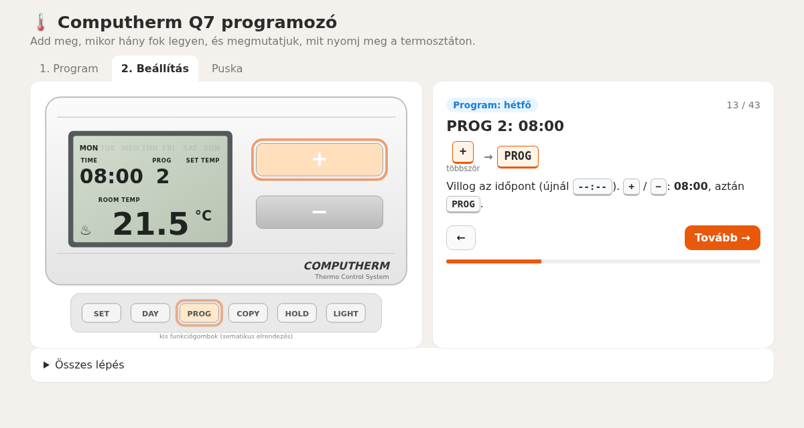

# Computherm Q7 programozó

Van egy **Computherm Q7** szobatermosztátod, és nem tudod, hogyan kell beprogramozni? Add meg, mikor hány fok
legyen, és az app végigvezet a beállításon a termosztát animált előlapján.

**Kipróbálható:** <https://pmamico.github.io/computherm-q7/> (AI nélkül)



## Mit tud

- **Típusválasztás**: a Q7-nek több változata van, és másképp programozhatók. Válaszd ki a tiédet a kis gombok
  felirata alapján:

  | Változat | Kis gombok |
  |---|---|
  | Q7 – újabb | SET, DAY, PROG, COPY, HOLD, LIGHT (napok: MON…SUN) |
  | Q7 – „új szoftverrel” | SET, DAY, PROG, COPY, HOLD, LIGHT (napok: 1–7) |
  | Q7 – régi | HOLD, DAY, LIGHT, RESET, COPY, PROG, SET |
  | Q7 RF – rádiós (régi) | HOLD, DAY, LIGHT, TEST, COPY, PROG, SET |

- **Heti program szerkesztése**: napcsoportok (pl. hétköznap / hétvége), alaphőfok és idősávok, heti előnézet.
  Figyelmeztet, ha egy napra több kapcsolás jutna, mint amennyit a Q7 tud (naponta 6).
- **Lépésről lépésre útmutató**: a kijelzőn villog, amit éppen állítasz, a megnyomandó gomb ki van emelve.
  Benne van a pontos idő beállítása, a programozás, az azonos napok másolása (`COPY`) és az ellenőrzés is.
- **Puska**: party, szabadság és tartós hőfok, gombzár, kalibrálás.
- **Opcionális AI**: szabad szövegből („hétköznap 6–8 és 16–22 között 21,5 fok, egyébként 18”) tölti ki
  a programot. Kulcs nélkül ez a rész egyszerűen nem jelenik meg.

Böngészőben fut, regisztráció és adatbázis nincs. A beállításaidat a böngésző `localStorage`-a őrzi.

## Indítás

### Dockerrel

```sh
git clone https://github.com/pmamico/computherm-q7.git
cd computherm-q7
docker compose up -d
```

Ezután nyisd meg: <http://localhost:8778>

### Docker nélkül

Csak Python 3.10+ kell, más függőség nincs:

```sh
python3 server.py            # http://127.0.0.1:8778
python3 server.py --host 0.0.0.0 --port 8080   # a helyi hálózatról is elérhető
```

### Statikus tárhelyen

AI nélkül a `web/` mappa magában is működik, bármilyen statikus tárhelyre feltehető (GitHub Pages, Netlify,
Cloudflare Pages). Ez a repó a [`.github/workflows/pages.yml`](.github/workflows/pages.yml) workflow-val
minden push után GitHub Pagesre teszi ki.

### AI-értelmezés bekapcsolása (opcionális)

Kell hozzá egy [Anthropic API-kulcs](https://console.anthropic.com/). Egy értelmezés a
Claude Haiku 5.5-tel nagyjából 1,5 ezer bemeneti és 0,3 ezer kimeneti token, ez a cent töredéke.

- Dockerrel: másold a `.env.example`-t `.env` néven, írd be a kulcsot, majd `docker compose up -d`.
- Docker nélkül: `pip install -r requirements.txt`, majd `ANTHROPIC_API_KEY=... python3 server.py`.

A modell a `Q7_AI_MODEL` változóval cserélhető.

## Hogyan működik

A szabályokat a gyártó (Quantrax Kft.) kezelési útmutatóiból modelleztem
([újabb Q7](https://files.szerelvenybolt.hu/pdf_2019/Computherm/Computherm_Q7_hasznalati_utasitas.pdf), valamint a régi Q7 és Q7 RF füzetei),
összefoglalva a [`docs/q7-modell.md`](docs/q7-modell.md) fájlban. Két logika van:

- **újabb Q7**: naponta egy rögzített kapcsolás (`PROG 0`/`P0`, 00:00) és 6 szabad, kikapcsolható;
- **régi Q7 és Q7 RF**: naponta pontosan 6 kapcsolás (P1–P6), a P6 hőfoka másnap P1-ig tart.

Az időpontok 10 percenként, a hőfok 0,5 fokonként állítható. Az app a napot 10 perces cellákra bontja,
a hőfokváltásokból képzi a kapcsolásokat, a régi típusoknál pedig ártalmatlan „töltelék” kapcsolásokkal egészít ki 6-ra. Az azonos programú
napokat egyszer programoztatja be, a többire `COPY`-val másol. Ha mind a 7 nap egyforma, mindet egyszerre állítja.

| Fájl | Mi van benne |
|---|---|
| `web/planner.js` | programozási modell és lépésgenerátor (böngészőben és node-ban is fut) |
| `web/thermostat.js` | a termosztát előlapjának animálható SVG-je |
| `web/app.js`, `index.html`, `style.css` | a felület |
| `server.py` | stdlib HTTP-szerver, opcionális `/api/parse` AI-végpont |

Tesztek: `node --test tests/*.test.mjs`

**Korlátok:** a kis gombok (`SET`, `DAY`, `PROG`, `COPY`, `HOLD`, `LIGHT`) helyét az útmutató nem írja le,
ezért az ábrán csak jelzésszerűek. Az időpontoknál az app a célértéket mutatja, nem a gombnyomások számát.

A Computherm a Quantrax Kft. védjegye. Ez egy független hobbiprojekt, nincs kapcsolatban a gyártóval.

## Licenc

[MIT](LICENSE)
